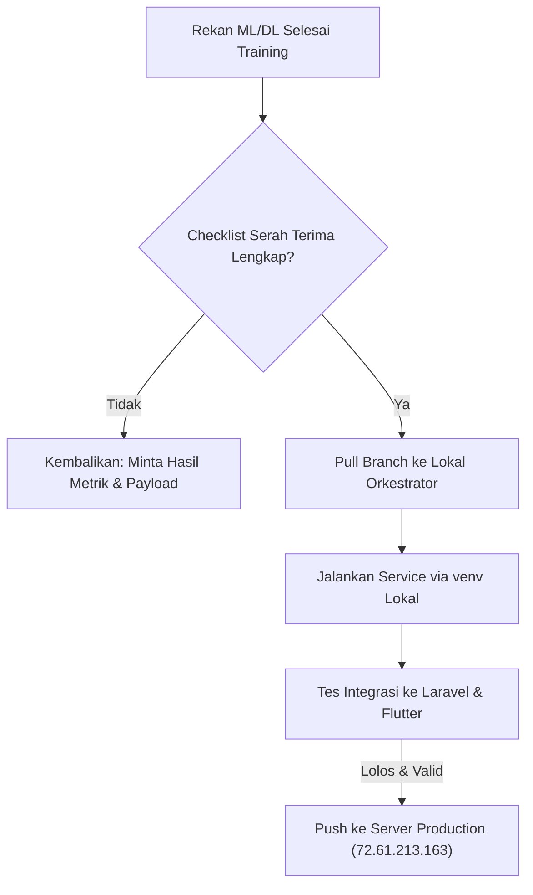

# 📘 PANDUAN MASTER: OPTIMASI MACHINE LEARNING & DEEP LEARNING PRENAVA
> **Disusun untuk:** Project Orchestrator & Tim Pengembang ML/DL Prenava  
> **Tujuan:** Panduan langkah-demi-langkah meningkatkan akurasi, sensitivitas klinis (Recall), dan performa model AI eksisting sebelum masuk ke produksi.

---

## 🗺️ DAFTAR ISI
1. [Arsitektur AI & Kondisi Baseline Saat Ini](#1-arsitektur-ai--kondisi-baseline-saat-ini)
2. [Model 1: Optimasi ML Stunting Screening (Tabular ML)](#2-model-1-optimasi-ml-stunting-screening-tabular-ml)
3. [Model 2: Optimasi DL Anemia Conjunctiva Detection (Computer Vision)](#3-model-2-optimasi-dl-anemia-conjunctiva-detection-computer-vision)
4. [Model 3: Optimasi ML Maternal Health & Sports Recommendation](#4-model-3-optimasi-ml-maternal-health--sports-recommendation)
5. [Standar Operasional Prosedur (SOP) Serah Terima Rekan Tim ke Orkestrator](#5-standar-operasional-prosedur-sop-serah-terima-rekan-tim-ke-orkestrator)
6. [Monitoring & Metric Checklist](#6-monitoring--metric-checklist)

---

## 1. Arsitektur AI & Kondisi Baseline Saat Ini

Sistem Prenava memiliki 3 model AI inti dengan karakteristik data yang berbeda:

| Fitur | Jenis Model | Algoritma Saat Ini | Dataset Asal | Performa Saat Ini | Target Optimasi |
| :--- | :--- | :--- | :--- | :--- | :--- |
| **Stunting Screening** | Tabular ML Binary | LightGBM / XGBoost | IFLS-5 (Indonesian Family Life Survey) | ROC-AUC: ~68%, F1: ~52%, Recall: ~59% | **Recall ≥ 80%**, **ROC-AUC ≥ 78%** |
| **Anemia Eye Scan** | Deep Learning CV | MobileNetV2 (`best_model_final.keras`) | Citra Konjungtiva Mata | Akurasi ~75-80% (rentan cahaya) | **F1-Score ≥ 85%**, ROI Segmentation |
| **Sports Recommendation** | Tabular ML + Rules | Random Forest + Rule Sync | UCI Maternal Health Risk | Akurasi ~70-75% | Personalisasi Trimester & Kontraindikasi |

> [!IMPORTANT]
> **Prinsip Utama AI Kesehatan (Medical AI):**
> Dalam deteksi risiko penyakit seperti Stunting dan Anemia, metrik yang paling krusial adalah **RECALL (Sensitivity)**.
> * *False Positive* (anak sehat diprediksi berisiko stunting) hanya berakibat ibu diberi edukasi gizi tambahan (tidak fatal).
> * *False Negative* (anak stunting diprediksi normal) berakibat anak tidak tertangani dan mengalami kegagalan pertumbuhan permanen (FATAL).
> **Oleh karena itu, target optimasi utama tim adalah memaksimalkan RECALL tanpa menghancurkan Precision.**

---

## 2. Model 1: Optimasi ML Stunting Screening (Tabular ML)

### A. Di Mana Datanya & Cara Menambah Dataset Baru
* **Dataset Baseline:** IFLS-5 (`hh14_b1`, `hh14_b3a`, `hh14_b5` di `D:\prenava\stunting\Data\raw`).
* **Kelemahan Data Lama:** Jumlah sampel setelah dibersihkan dan difilter hanya ratusan anak, dengan ketidakseimbangan kelas (*imbalanced data* ~30% stunting).
* **Sumber Dataset Tambahan yang Bisa Digunakan Rekan Tim:**
  1. **Dataset SSGI / Riskesdas Publik (Kemenkes RI):** Data Survei Status Gizi Indonesia.
  2. **Kaggle Stunting Datasets (Balita Indonesia):**
     * *Indonesia Child Stunting Dataset* (berisi kolom: Umur, Jenis Kelamin, Tinggi Badan, Status Menyusui).
     * *WHO Child Growth Standards (Z-score Antropometri)*: Standar baku WHO untuk tinggi/panjang badan menurut umur (HAZ / TB/U).
  3. **Data Sintesis Terpandu (SMOTE / ADASYN):** Rekan tim dapat menggunakan teknik oversampling sintetis untuk memperbanyak sampel minoritas stunting.

### B. Tahapan Eksekusi untuk Rekan ML

#### Tahap 1: Data Preprocessing & Feature Engineering
Minta rekan ML Anda membuat fitur-fitur baru (*feature engineering*) dari data mentah:
1. **HAZ (Height-for-Age Z-Score):**
   Hitung deviasi standar tinggi badan anak terhadap median baku WHO:
   $$\text{Z-Score} = \frac{\text{Tinggi Anak} - \text{Median WHO}}{\text{Standar Deviasi WHO}}$$
2. **Kategori IMT Ibu (Body Mass Index):** $\text{BMI} = \frac{\text{Berat Ibu (kg)}}{(\text{Tinggi Ibu (m)})^2}$. Ibu dengan KEK (Kurang Energi Kronis) jika lingkar lengan atas (LiLA) < 23.5 cm.
3. **Rasio Akses Sanitasi & Air Bersih:** Variabel biner (1 jika air bersih layak, 0 jika tidak).
4. **Riwayat ASI Eksklusif (0–6 bulan):** Variabel biner yang sangat berkorelasi dengan kekebalan usus balita.

#### Tahap 2: Menangani Ketidakseimbangan Data (Class Imbalance)
Dalam script training Python (`stunting_paper_final.py`), tambahkan:
```python
from imblearn.over_sampling import SMOTE
from imblearn.combine import SMOTETomek

# Menyeimbangkan kelas stunting vs normal
smt = SMOTETomek(random_state=42)
X_train_res, y_train_res = smt.fit_resample(X_train, y_train)
```

#### Tahap 3: Hyperparameter Tuning & Threshold Calibration
Model LightGBM saat ini menggunakan threshold default `0.5`. Dengan menurunkan threshold prediksi (misal ke `0.38` atau `0.42`), nilai Recall akan melonjak tinggi:
```python
# Kalibrasi threshold untuk memaksimalkan Recall
import numpy as np

probabilities = model.predict_proba(X_test)[:, 1]
custom_threshold = 0.40  # Threshold optimal hasil kurva Precision-Recall
y_pred_optimized = (probabilities >= custom_threshold).astype(int)
```

#### Tahap 4: Export Model Final
Setelah metrik Recall mencapai ≥ 80%:
Simpan model beserta transformer-nya menggunakan `joblib`:
```python
import joblib

joblib.dump({
    'model': best_lightgbm_model,
    'scaler': standard_scaler,
    'features': feature_columns_list,
    'threshold': custom_threshold
}, 'models/model_stunting_v2.joblib')
```

---

## 3. Model 2: Optimasi DL Anemia Conjunctiva Detection (Computer Vision)

### A. Sumber Dataset Citra Mata Konjungtiva
* **Kelemahan Model Saat Ini:** Mengklasifikasikan seluruh gambar mata (bukan hanya area konjungtiva), sehingga sering terkecoh oleh warna kulit wajah, bayangan cahaya, atau pantulan flash kamera.
* **Dataset Terbuka yang Wajib Diunduh Rekan DL:**
  1. **Anemia Conjunctiva Image Dataset (Mendeley Data):**
     * Berisi 4000+ foto konjungtiva mata berlabel kadar hemoglobin (Hb) dan status Anemia / Non-Anemia.
     * URL: `https://data.mendeley.com/datasets/btv22hrvtr/`
  2. **Kaggle Eyepacs / Conjunctiva Anemia Dataset:**
     * Kumpulan foto kelopak mata bawah yang sudah dipotong (*cropped*).

### B. Tahapan Optimasi untuk Rekan Deep Learning

#### Tahap 1: Region of Interest (ROI) Cropping / Detection
Jangan langsung menyuapkan foto mata utuh ke classifier. Alur terbaik:
1. **Deteksi Mata (YOLOv8 Nano atau Mediapipe Face Mesh):** Deteksi koordinat mata dan kelopak mata bawah (*palpebral conjunctiva*).
2. **Crop Konjungtiva:** Hanya potong bagian dalam kelopak mata bawah yang kemerahan/pucat.
3. **Resize ke 224x224:** Masukkan hasil potongan ke model CNN.

#### Tahap 2: Data Augmentation yang Tepat untuk Medis
Pada citra medis, jangan gunakan augmentasi yang mengubah warna ekstrem (seperti sembarangan mengubah hue), karena warna merah/pucat adalah fitur diagnosis utama!
Gunakan augmentasi berikut di Keras/TensorFlow:
```python
from tensorflow.keras import layers

data_augmentation = tf.keras.Sequential([
    layers.RandomFlip("horizontal"),
    layers.RandomRotation(0.05),      # Rotasi sangat kecil (maks 5%)
    layers.RandomZoom(0.1),           # Zoom in/out sedikit
    layers.RandomBrightness(0.1),     # Variasi cahaya tipis (±10%)
])
```

#### Tahap 3: Arsitektur Model (Transfer Learning)
Ganti atau bandingkan MobileNetV2 dengan arsitektur modern yang lebih peka tekstur:
1. **EfficientNet-B0 atau EfficientNetV2-B1:** Memiliki parameter ringan namun representasi fitur warna jauh lebih akurat dibanding MobileNet lama.
2. **Konfigurasi Fine-Tuning 2-Langkah:**
   * *Step 1:* Freeze base model, latih classification head selama 10 epoch dengan Learning Rate $10^{-3}$.
   * *Step 2:* Unfreeze 30 layer teratas base model, latih dengan Learning Rate sangat kecil ($10^{-5}$) selama 20 epoch.
```python
base_model = tf.keras.applications.EfficientNetV2B0(
    include_top=False, weights='imagenet', input_shape=(224, 224, 3)
)
base_model.trainable = False

# Bangun Head
inputs = tf.keras.Input(shape=(224, 224, 3))
x = data_augmentation(inputs)
x = tf.keras.applications.efficientnet_v2.preprocess_input(x)
x = base_model(x, training=False)
x = layers.GlobalAveragePooling2D()(x)
x = layers.Dropout(0.3)(x)
outputs = layers.Dense(1, activation='sigmoid')(x)
model = tf.keras.Model(inputs, outputs)
```

#### Tahap 4: Export Model ke Production
Simpan ke format Keras modern (`model_anemia_v2.keras`) dan catat threshold optimalnya.

---

## 4. Model 3: Optimasi ML Maternal Health & Sports Recommendation

### A. Analisis Masalah Saat Ini
* Dataset `maternal_health.csv` di `D:\prenava\ml-service-sport-new\data` hanya memetakan 6 parameter umum ke tingkat risiko (`low`, `mid`, `high`).
* Rekomendasi olahraga membutuhkan **konteks klinis kehamilan**:
  * Trimester ke berapa? (Trimester 1 rawan keguguran; Trimester 3 tidak boleh posisi terlentang/supine).
  * Apakah ada pendarahan, ketuban pecah dini, atau preeklampsia?

### B. Tahapan Optimasi Rekan ML Sports
1. **Hybrid Rule-ML Architecture:**
   * *Layer 1 (Hard Medical Safety Filter):* Jika tekanan darah > 140/90 mmHg atau ada keluhan kontraksi dini -> **DILARANG OLAHRAGA** (rekomendasikan istirahat dan konsultasi bidan).
   * *Layer 2 (ML Fit Classifier):* Jika aman, model memprediksi level intensitas kebugaran (Ringan, Sedang, Pemeliharaan Fleksibilitas).
2. **Sinkronisasi Rules:** Pastikan endpoint sinkronisasi `/recomendation/sport-sync` membaca kategori olahraga yang ramah ibu hamil dari database Laravel.

---

## 5. Standar Operasional Prosedur (SOP) Serah Terima Rekan Tim ke Orkestrator

Sebagai **Project Orchestrator**, jangan terima model jika rekan Anda hanya menyerahkan file model tanpa bukti pengujian. Terapkan checklist wajib berikut:



### 📋 Format Laporan Serah Terima (Wajib Diserahkan Rekan Tim)
Setiap rekan tim ML yang mengajukan model baru harus menyertakan dokumen ringkas 1 halaman:
1. **Nama & Versi Model:** Misal `Stunting-LightGBM-v2.1`
2. **Dataset yang Digunakan:** Jumlah data latih (*train*) dan data uji (*test*).
3. **Tabel Confusion Matrix & Metrik Evaluasi:**
   * Accuracy
   * Precision
   * **Recall (Sensitivity)** -> Wajib di atas 80%
   * F1-Score
   * ROC-AUC
4. **Contoh Payload JSON Request & Response:**
   ```json
   {
     "tinggi_badan_ibu": 150,
     "berat_badan_ibu": 48,
     "usia_kehamilan": 24,
     "lila": 22.0
   }
   ```
5. **Daftar Dependensi Baru:** Jika ada library baru yang dipasang di `requirements.txt`.

---

## 6. Monitoring & Metric Checklist

| Model | Metrik Minimal Lolos Uji | File Artefak Output | Folder Service di Prenava |
| :--- | :--- | :--- | :--- |
| **Stunting ML** | Recall ≥ 80%, ROC-AUC ≥ 0.75 | `model_stunting_v2.joblib` | `D:\prenava\ml-service-stunting` & `D:\prenava\stunting` |
| **Anemia DL** | Sensitivity ≥ 85%, F1 ≥ 82% | `best_anemia_v2.keras` | `D:\prenava\ml-anemia` |
| **Sports ML** | Accuracy ≥ 85%, Zero False-Safety | `model_sports_v2.joblib` | `D:\prenava\ml-service-sport-new` |
